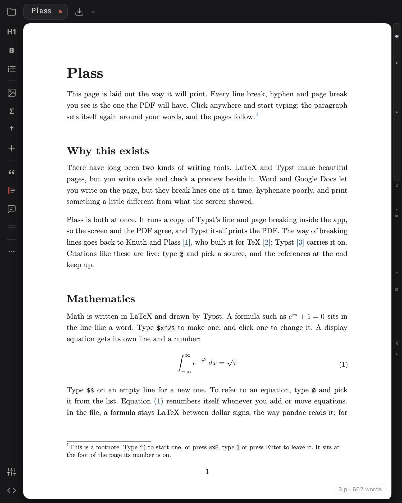
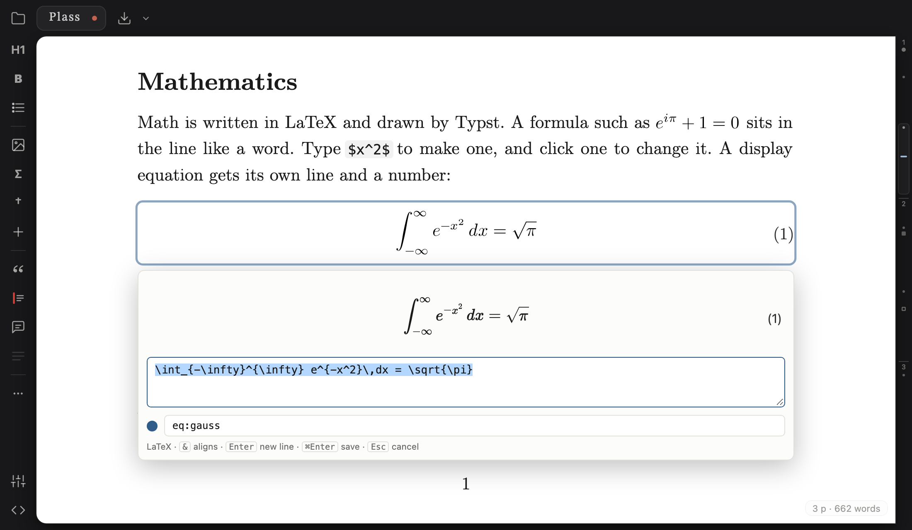
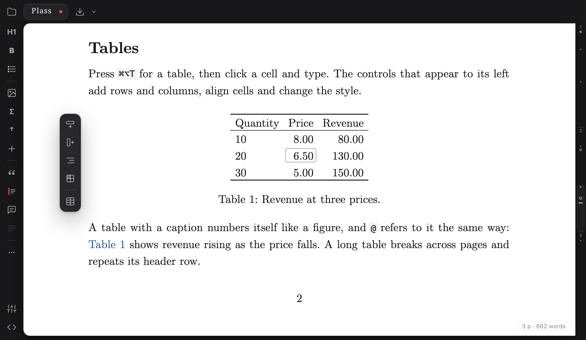
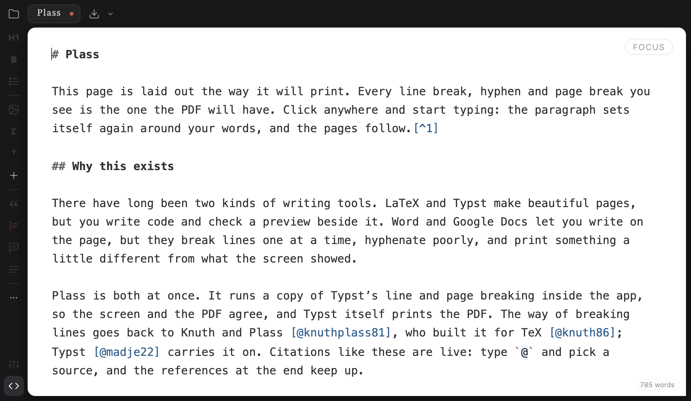

# Plass

Plass is a writing app that shows you the printed page while you type.
Every line break, hyphen and page break on the screen is the one the PDF
will have.

Try it in your browser: **<https://plass.tayweid.io>**

<p align="center">
  
</p>

## Why

Writing tools come in two kinds. LaTeX and Typst make beautiful pages, but
you write code and look at a preview beside it. Word and Google Docs let you
write on the page, but their layout is crude: lines break one at a time,
hyphenation is poor, and the printout never quite matches the screen.

Plass lets you write on the page, and lays that page out the way Typst
does. It runs a copy of Typst's line and page breaking inside the app, so
the screen and the PDF agree, and Typst itself prints the PDF.

## Install the Mac app

Paste this into Terminal:

```sh
curl -fsSL https://plass.tayweid.io/install | bash
```

This puts Plass in Applications. It works offline after that. Run the same
line again to update. Needs macOS 13 or later. To make Plass open your
`.md` files, choose it under **Open With** in a file's **Get Info**.

You can also install the web version as an app: in Chrome, **⋯ → Install
Plass** on the left rail; in Safari, **File → Add to Dock**.

## Your files

A Plass document is a plain Markdown file (`.md`). You can open it in any
text editor, keep it in git, or run it through pandoc. Its settings (paper,
fonts, page numbers) sit in the front matter at the top of the file. Plass
saves to the file as you type. To write a Plass file by hand, or have a
model write one, see [Plass Markdown](./docs/MARKDOWN-FORMAT.md).

**Export** is the download button at the top (⌘E). One click makes a PDF;
the arrow beside it gives Markdown, Typst (`.typ`) or LaTeX (`.tex`). The
PDF is made by Typst inside the app: nothing to install, nothing sent over
the network.

Older `.typ` documents still open and save as Typst.

## What you can write

- **Text**: headings, paragraphs, bold, italic, strikethrough, bulleted
  and numbered lists. Typing Markdown works (`#`, `**bold**`, `- `).
- **Math** in LaTeX: `$…$` inline, `$$` on an empty line for a display
  equation. Equations number themselves; type `@` to refer to one.
- **Footnotes**: type `^[`, or ⌘⌥F. They sit at the bottom of their page.
- **Figures**: paste or drop an image. Captions number themselves.
- **Tables**: editable cells, booktabs or grid style, merged cells,
  column widths. Long tables break across pages and repeat the header.
- **Grids**: blocks side by side, such as a paragraph beside a figure.
- **Citations**: keep a BibTeX bibliography in the document, type `@` to
  cite. IEEE, APA or Chicago style.
- **Solutions**: a red block with a rule down the side, for answer keys.
- **Comments**: notes to yourself. Shown on screen, never printed.
- **Page settings** (the sliders at the bottom of the rail): paper size,
  margins, type size, line spacing, page numbers, running headers and
  footers, section numbers.

Click a formula to change it. You type LaTeX; the page shows what Typst
will print.



Click into a table and its controls appear in the margin beside it.



**Plain text** (⌘/, the `<>` at the bottom of the rail) shows the same
document as Markdown text, for when you'd rather just type.



## What Plass won't do

Plass supports the list above, not all of Typst. That is what lets the
screen match the print exactly.

Anything else in a file, such as raw Typst or HTML, is kept exactly as
written. Plass shows it as a code block, labeled in the margin, and prints
it that way too. It never runs it, so nothing is hidden and nothing is
lost.

Some things are left out on purpose: multi-column pages, floating figures,
custom Typst styling. If a document needs them, export it to Typst and
finish it there.

There is one font for now: New Computer Modern, the classic TeX look.

## Keys

| Keys | Does |
| --- | --- |
| ⌘S / ⌘O | Save / open |
| ⌘E | Export PDF |
| ⌘/ | Switch between the page and plain text |
| ⌘B / ⌘I | Bold / italic |
| ⌘⌥1–3, ⌘⌥0 | Heading 1–3, back to body text |
| ⌘M / ⌘⇧M | Inline math / display equation |
| ⌘⌥F | Footnote |
| ⌘⌥T / ⌘⌥I | Table / figure |
| ⌘⏎ | Page break |
| `@` | Cite, or refer to an equation, figure or section |

The full list is in the app: **⋯ → ?** on the left rail.

## Status

Plass is a public preview, built and kept up by one person. Back up work
you care about. Report bugs as GitHub issues ([Support](./SUPPORT.md));
report security problems privately ([Security](./SECURITY.md)). Plass has
no accounts, no server and no tracking ([Privacy](./PRIVACY.md)).

## Working on Plass

```sh
npm ci
npm run dev      # http://localhost:5199
```

[CONTRIBUTING.md](./CONTRIBUTING.md) has the checks to run before a push.
[PORT.md](./PORT.md) and [PAGE-PORT.md](./PAGE-PORT.md) explain how the
layout copies Typst's. [ROADMAP.md](./ROADMAP.md) is what's next. `npm run screenshots` (with
the dev server running) retakes the pictures in this README.

## The name

Plass is named for Michael F. Plass, who with Donald Knuth wrote the
line-breaking method TeX uses. It rhymes with "class".

## License

[MIT](./LICENSE). Bundled fonts and libraries keep their own licenses
([notices](./THIRD_PARTY_NOTICES.md)).
